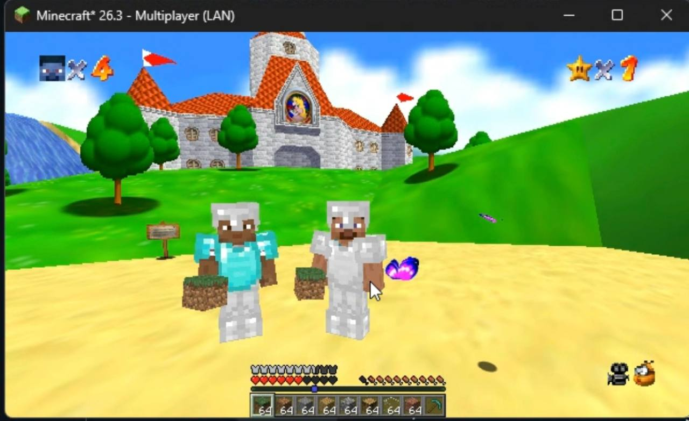
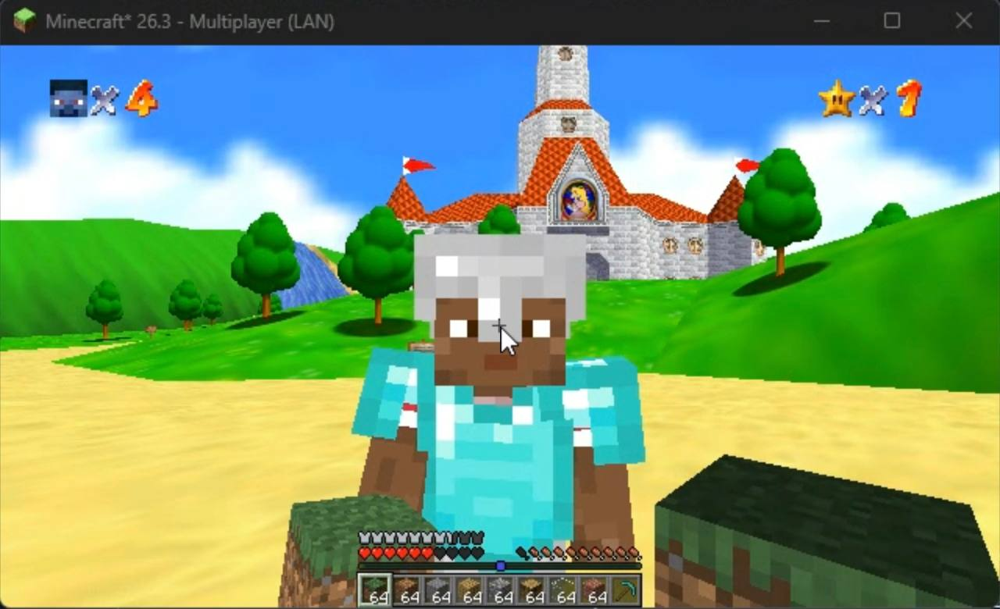

# SM64Craft

**Steve chegou ao Reino do Cogumelo.** SM64Craft coloca a imagem do Super Mario 64 Coop DX dentro da janela do Minecraft e liga os dois jogos: você controla Steve, enquanto os cursos, inimigos e estrelas continuam vindo do SM64.

  
  

**[Baixar a versão mais recente](https://github.com/GuiiDEV1/SM64Craft/releases/latest)**

> Projeto experimental para Minecraft Java. O download não contém uma ROM nem arquivos de jogo da Nintendo ou da Mojang. Você precisa fornecer sua própria ROM USA de Super Mario 64.

## A ideia

O Minecraft cuida do Steve, de seus itens, equipamentos e mundo aberto. O SM64 Coop DX cuida das fases e da lógica de Super Mario 64. O mod mantém os dois lados sincronizados e mostra a imagem do jogo na janela do Minecraft.

Na prática, dá para correr, pular, lutar e explorar usando Steve, quebrar partes do cenário para obter blocos e colocar construções que interagem com a geometria do SM64. Espadas, machados, arcos e a mace servem para enfrentar os inimigos. Os movimentos clássicos de Mario também estão disponíveis: salto duplo e triplo, salto longo, mortal para trás, wall kick e ground pound.

## Preparar e iniciar

O instalador automático desta versão funciona no **Windows 10/11 de 64 bits**. Também são necessários Minecraft Java **26.3**, Fabric Loader, Fabric API, Java **25** na instância e conexão com a internet durante a instalação. O JAR não instala Minecraft, Fabric ou Java.

1. Instale Fabric Loader e Fabric API na instância 26.3 e copie o JAR baixado para a pasta `mods` dessa instância.
2. Abra o Minecraft e clique em **Instalar dependências** no menu principal. Na tela que abrir, escolha **Abrir pasta sm64craft**.
3. Copie sua ROM USA para a pasta aberta. São aceitos arquivos `.z64`, `.n64` e `.v64`; o instalador verifica se o arquivo é a versão suportada e cria uma cópia normalizada sem alterar o original.
4. Volte ao Minecraft e clique em **Instalar dependências**. O botão baixa o lançamento oficial do SM64 Coop DX, aplica a modificação localmente e instala o e4mc na instância.
5. Quando a instalação terminar, reinicie o Minecraft uma vez para carregar o e4mc. No menu principal, clique no botão do mod para abrir o SM64 Coop DX dentro do Minecraft.

Os arquivos do jogo, a cópia verificada da ROM, os saves do SM64 e o log ficam na pasta `sm64craft` dentro do diretório de jogo da instância. O e4mc fica em `mods`. A instalação de lançamento usa um pacote nativo pronto; não exige que o jogador compile o SM64 Coop DX.

## Jogar com amigos

Todos devem usar a mesma versão do SM64Craft, ter uma instância Fabric compatível e fornecer sua própria ROM USA. O host abre seu mundo Minecraft para LAN e cria a sessão multiplayer no SM64 Coop DX. Os amigos entram na sessão do SM64 pelo menu multiplayer do jogo; a integração encaminha o endereço e4mc e conecta os clientes Minecraft ao mundo do host. Não é necessário criar um servidor Minecraft separado nem configurar encaminhamento de portas no roteador.

O multiplayer passou por testes com vários clientes locais: conexão entre os mundos, inventários, blocos, mortes, progresso de estrelas, reconexão e transições de fase. DDD e WDW foram exercitadas nos dois sentidos. Se precisar conectar manualmente ao endereço e4mc do host, use `/join <endereço>` no chat; `/leave` volta à sua sessão local. Ainda faltam partidas completas entre computadores físicos com contas Microsoft distintas e uma verificação manual de toda a campanha. Consulte o [relatório de validação](docs/MULTIPLAYER-VALIDATION.md) para os testes e limites conhecidos.

## Movimentos adicionais

| Movimento | Como fazer |
| --- | --- |
| Salto duplo ou triplo | Pressione Espaço novamente ao aterrissar; corra para o triplo |
| Salto longo | Shift + Espaço enquanto corre |
| Mortal para trás | Shift + Espaço parado |
| Wall kick | Espaço no ar, junto a uma parede |
| Ground pound | Segure Shift durante a aterrissagem |
| Conversar ou pegar um objeto | Botão direito do mouse |
| Controlar slide, canhão ou casco | WASD e mouse; Espaço para sair |
| Pausa / sair da fase | P |
| Alternar câmera | F5 |
| Mostrar estado para diagnóstico | F7 |

## Onde ficam seus dados

- **Progresso e ROM:** `sm64craft/` no diretório de jogo da instância. O arquivo reconhecido fica como `baserom.us.z64` e o progresso do SM64 fica em `saves/`.
- **Mundos Minecraft:** continuam na pasta `saves/` normal da instância.
- **Log de instalação:** `sm64craft/install.log`.

Para remover o SM64Craft, feche o Minecraft e apague o JAR do mod em `mods`. A instalação também coloca o JAR do e4mc nessa pasta; remova-o caso não o utilize com outros mods. Apagar `sm64craft/` remove o jogo nativo, os saves do SM64 e tudo que você guardou nessa pasta, inclusive os arquivos de ROM. Faça uma cópia dos dados que quiser preservar antes de removê-la.

## Limites conhecidos

O SM64Craft ainda está em desenvolvimento. Os testes de multiplayer e de passagens entre fases não equivalem a concluir cada curso manualmente. Contas oficiais em computadores separados, todos os chefes, toda a campanha e quedas prolongadas de conexão ainda precisam de validação adicional. Alguns textos da interface do pacote atual podem conservar nomes internos anteriores.

Encontrou um problema? Abra uma [issue no GitHub](https://github.com/GuiiDEV1/SM64Craft/issues) e, se possível, inclua `sm64craft/install.log` ou `logs/latest.log` da instância.

## Créditos e licenças

O jogo nativo vem do [SM64 Coop DX](https://github.com/coop-deluxe/sm64coopdx), da equipe Coop Deluxe. A integração que permite exibir outro jogo dentro do Minecraft começou no [SkyCraft](https://github.com/chasmlol/SkyCraft), de chasm. Este projeto também utiliza Fabric, Fabric API e e4mc.

O código próprio do SM64Craft está sob MIT (`LICENSE`). Cada dependência conserva sua licença; consulte [`THIRD-PARTY-NOTICES.md`](THIRD-PARTY-NOTICES.md) e `licenses/`. SM64Craft não é afiliado à Nintendo, Mojang Studios ou Microsoft. Use cópias dos jogos que você possui e não distribua ROMs.
